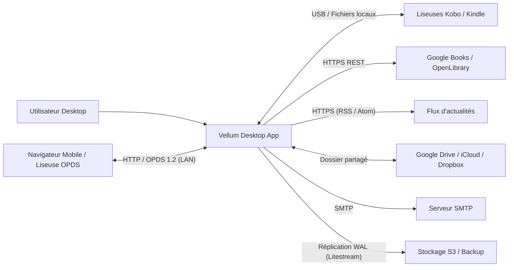
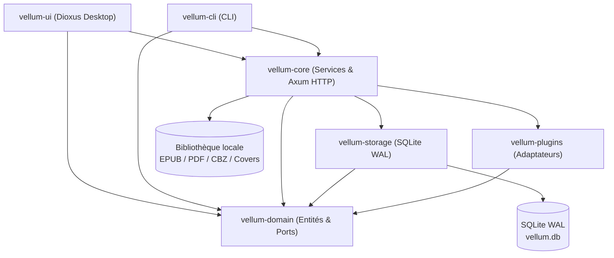
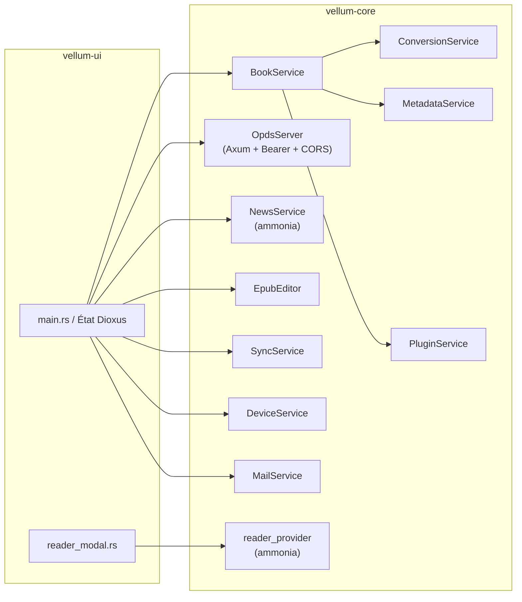

# Architecture & Modèle C4 — Vellum

Ce document décrit l'architecture logicielle de **Vellum** selon le modèle **C4** (Contexte, Conteneurs, Composants, Code) et les règles d'isolation entre couches.

---

## 1. Niveau C1 — Contexte Système

Vellum s'exécute sur le poste de l'utilisateur et interagit avec des liseuses USB, des clients OPDS/navigateurs sur le réseau local, des APIs externes de métadonnées et des backends de synchronisation.

---

## 2. Niveau C2 — Conteneurs

Le workspace Rust (`Cargo.toml` / `crates/`) est découpé suivant le principe d'inversion de dépendances (Clean Architecture) :

| Crate | Rôle principal | Dépendances externes majeures |
| :--- | :--- | :--- |
| `vellum-domain` | Entités, traits/ports, configurations, `VellumError` | `serde`, `chrono`, `uuid`, `thiserror`, `dirs` |
| `vellum-storage` | Dépôts SQLite WAL (`BookRepository`, `TagRepository`, `ParamRepository`, `SyncRepository`) | `rusqlite` |
| `vellum-plugins` | Formats, convertisseurs, enrichissement, Kobo/Kindle, traduction, plugins CLI externes | `reqwest`, `zip`, `rusqlite` (RO Kobo) |
| `vellum-core` | Cas d'usage métier, lecteur, sanitisation `ammonia`, i18n FR/EN, serveur OPDS/Web Companion | `axum`, `tower-http`, `ammonia`, `zip`, `lettre`, `rusqlite` (RO Calibre) |
| `vellum-cli` | Automatisation CLI (`import`, `list`, `audit`, `index`, `search-content`, `convert`, `export`) | `vellum-core`, `vellum-domain` |
| `vellum-ui` | Interface desktop réactive Dioxus, composants modaux, CSS | `dioxus` |

---

## 3. Niveau C3 — Composants (`vellum-core`)

À l'intérieur de `vellum-core`, les responsabilités sont séparées par service métier :

### Flux clés

1. **Import et organisation** : `BookService::import_book` détecte le format via `PluginService`, extrait les métadonnées, génère un nom de fichier sûr via `BookService::sanitize_filename` et un chemin via `NamingTemplate`, puis persiste dans `BookRepository`.
2. **Lecture sécurisée** : `reader_provider` extrait le chapitre EPUB/CBZ/TXT, réécrit les images embarquées en `data:image/...` et passe le HTML dans `sanitize_reader_html` (`ammonia`).
3. **Web Companion & OPDS** : `OpdsServer` expose `/opds` (XML Atom), `/api/*` (JSON) et `/read/{id}` (HTML) derrière un middleware optionnel `Bearer` et des en-têtes HTTP de sécurité.

---

## 4. Niveau C4 — Règles de découpe et points d'attention

- **Pureté du domaine** : `vellum-domain` ne doit jamais importer `rusqlite`, `axum`, `zip` ou `dioxus`. Les erreurs techniques (`zip::result::ZipError`, erreurs SQLite) sont converties en `VellumError` dans les couches adaptateur/application.
- **Accès SQLite externes en lecture seule** : `vellum-core` (`calibre_importer.rs`) et `vellum-plugins` (`ereader/kobo.rs`) utilisent `rusqlite` exclusivement avec `OpenFlags::SQLITE_OPEN_READ_ONLY` pour lire des bases tierces (`metadata.db`, `KoboReader.sqlite`). Toute écriture applicative passe par `vellum-storage`.
- **Découpage et modularité** :
  - `vellum-ui/Cargo.toml` dépend exclusivement de `vellum-core` et `vellum-domain` (aucune dépendance directe vers `vellum-storage` ou `vellum-plugins`).
  - Les services et composants majeurs sont découpés en sous-modules thématiques (`book_service/`, `epub_editor/`, `reader_provider/`, `opds_server/`, `sync_service/`, `reader_modal/`, `detail_drawer/`, `settings_modal/`, `epub_editor_modal/`).

